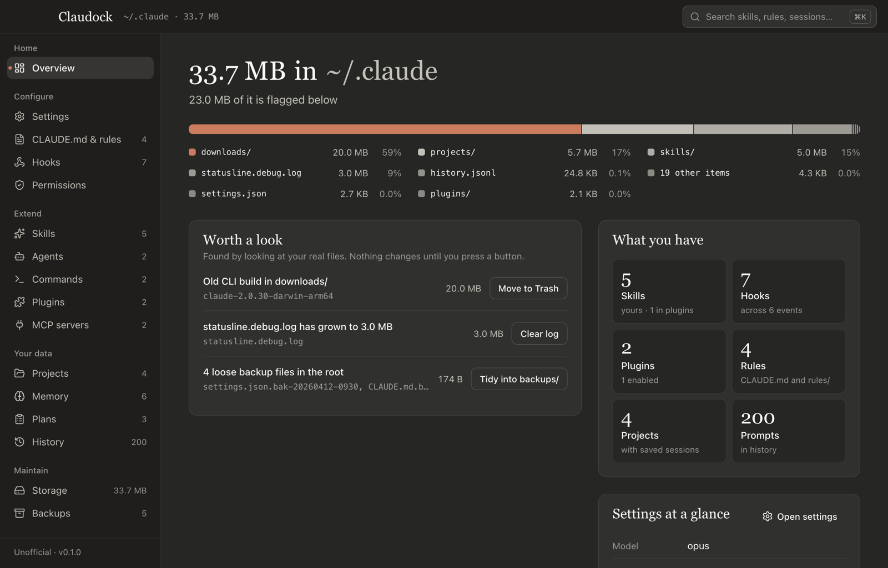

# Claudock

Manage your Claude Code setup (settings, hooks, skills, MCP servers, memory and more) in one window, without hand-editing the JSON and Markdown in `~/.claude`.

**Beta, actively maintained** · macOS, Windows, Linux · [Source-available license](#license): free for personal use and inside your company, no redistribution · Unofficial, not affiliated with Anthropic



## What it does

Claudock is a desktop app for the Claude Code config folder (`~/.claude`, or wherever `CLAUDE_CONFIG_DIR` points) and the MCP servers in `~/.claude.json`. It has one screen for each part of the folder:

- **Configure:** `settings.json` and `settings.local.json` as a form or raw JSON with history, `CLAUDE.md` and `rules/`, hooks, permissions
- **Extend:** skills (turn on or off, edit, duplicate), agents, commands, plugins, MCP servers
- **Your data:** projects and their session transcripts, memory, plans, prompt history
- **Maintain:** disk use per folder with cleanup suggestions, plus snapshots and `.bak` files you can diff and restore

⌘K (Ctrl+K on Windows and Linux) searches skills, agents, rules, hooks, sessions, memory and settings keys.

## Why not just edit the files

Claude Code keeps its config in dozens of JSON, JSONL and Markdown files, and rewrites `~/.claude.json` while it runs. Claudock edits them safely:

- Before every change it saves a snapshot of the file outside `~/.claude`. It then writes to a temp file and renames it over the original, so a crash can't leave a half-written file. JSON is validated before it is written.
- For `~/.claude.json` it re-reads the file right before writing and changes only the key you edited, so it doesn't overwrite what Claude Code wrote in the meantime.
- Deletes go to the OS Trash.
- It never reads `.credentials.json` or `sessions/*.key`. They show up as locked rows.

What it doesn't do: it doesn't run, update or sign in to Claude Code, and it doesn't sync settings between machines. It only works on the config folder and `~/.claude.json`, not on the `.claude/` folders inside your repositories. If you only change a setting now and then, Claude Code's own `/config` and `/permissions` commands are enough.

At launch Claudock downloads Anthropic's public settings docs (code.claude.com) and the Claude Code JSON schema to power the JSON editor's suggestions. It asks json.schemastore.org and the schema's GitHub mirror (raw.githubusercontent.com) at the same time and uses whichever answers first. It sends nothing about your config.

## Try it without touching your config

Requires Node.js 22.12 or later (Electron 45 and Vite 8 need it) and git.

```sh
git clone https://github.com/behkha/claudock.git
cd claudock
npm install
npm run dev
```

`npm run dev` opens the app on a synthetic config folder that it generates in `./.fixture/claude`. To look at your real `~/.claude` with every write turned off, run `npm run dev:real` instead.

## Install

Prebuilt downloads will be published on [GitHub Releases](https://github.com/behkha/claudock/releases). Until then, build the installer yourself from the clone above:

```sh
npm run dist:mac      # or dist:win, dist:linux
```

The output goes to `./dist`:

| Platform | Files |
|---|---|
| macOS | `Claudock-<version>-arm64.dmg`, `Claudock-<version>-x64.dmg` |
| Windows | `Claudock-Setup-<version>.exe` |
| Linux | `.AppImage` and `.deb`, for x64 and arm64 |

macOS builds are ad-hoc signed and not notarized. They open normally on the Mac that built them. On another Mac, Gatekeeper may block them.

The installed app reads and writes `~/.claude`, or the folder in `CLAUDE_CONFIG_DIR` if you set it.

## Status

Beta (v0.1.0), actively maintained. There are no tagged releases yet. Bug reports are welcome in [Issues](https://github.com/behkha/claudock/issues).

## License

Claudock is source-available, not open source. You may use it under your choice of the [PolyForm Strict License 1.0.0](https://polyformproject.org/licenses/strict/1.0.0) (personal and noncommercial use) or the [PolyForm Internal Use License 1.0.0](https://polyformproject.org/licenses/internal-use/1.0.0) (use inside your company). Neither allows distributing, reselling or rebranding it. See [LICENSE.md](LICENSE.md).

Claudock is unofficial and is not affiliated with or endorsed by Anthropic. It uses Anthropic's palette and type styles but not the Claude or Anthropic logos.

## Development

The fixture rule, scripts, code layout and how to add an IPC method are in [docs/DEVELOPMENT.md](docs/DEVELOPMENT.md). The build spec is [docs/SPEC.md](docs/SPEC.md).
