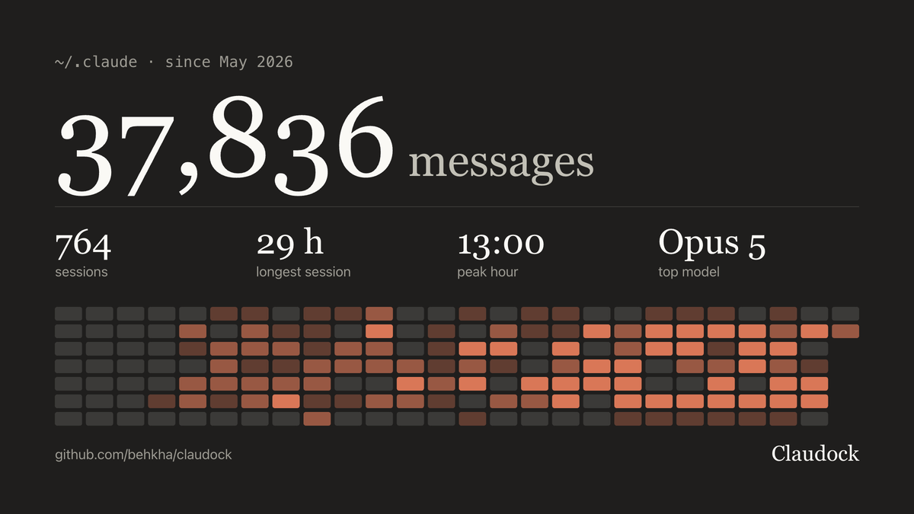

# Claudock

See inside your `~/.claude`. Claudock is a free desktop app that lists every skill, hook, MCP server and session, and charts six months of your Claude Code use. Every edit starts with a snapshot.

**Beta, actively maintained** · macOS, Windows, Linux · [MIT license](LICENSE.md) · Unofficial, not affiliated with Anthropic

`npx claudock` · [Download](https://github.com/behkha/claudock/releases/latest) · [Website](https://behkha.github.io/claudock/)




## What it does

Claudock opens the Claude Code config folder (`~/.claude`, or wherever `CLAUDE_CONFIG_DIR` points) and the MCP servers in `~/.claude.json`, with one screen for each part:

- **Today:** what each running Claude Code session is doing and which one waits for you, your 5-hour and weekly limits, today's sessions and this week's tokens, and **Share**: your messages, sessions, longest session, peak hour, top model and 26 weeks of activity from Claude Code's own `stats-cache.json`, as a card to copy, save or post on X. The card never shows project names or prompts.
- **Configure:** `settings.json` and `settings.local.json` as a form or raw JSON with history, `CLAUDE.md` and `rules/`, hooks, permissions
- **Extend:** skills (turn on or off, edit, duplicate), agents, commands, plugins, mods (what each one draws, hooks and reaches; keep the ones Claude drafts), MCP servers
- **Your data:** every session, kept after Claude Code's 30-day cleanup deletes it, with full-text search, resume from any folder and Markdown export; projects, memory, plans, prompt history
- **Maintain:** disk use per folder with cleanup suggestions, plus snapshots and `.bak` files you can diff and restore

**Menu bar** (the tray on Windows and Linux): the higher of your 5-hour and weekly limits, and a clay mark while a Claude Code session waits for you. Click it for the waiting sessions, both limits, today's tokens and the alert settings. On macOS, closing the window keeps Claudock running there; quit from its menu. On Windows the tray icon is off until you turn it on in View › Show in Tray.

⌘K (Ctrl+K on Windows and Linux) searches skills, agents, rules, hooks, sessions, memory and settings keys.

## Why not just edit the files

Claude Code keeps its config in dozens of JSON, JSONL and Markdown files, and rewrites `~/.claude.json` while it runs. Claudock edits them safely:

- Before every change it saves a snapshot of the file outside `~/.claude`. It then writes to a temp file and renames it over the original, so a crash can't leave a half-written file. JSON is validated before it is written.
- For `~/.claude.json` it re-reads the file right before writing and changes only the key you edited, so it doesn't overwrite what Claude Code wrote in the meantime.
- Deletes go to the OS Trash.
- It never reads `.credentials.json` or `sessions/*.key`. They show up as locked rows.

What it doesn't do: it doesn't run, update or sign in to Claude Code, and it doesn't sync settings between machines. It only works on the config folder and `~/.claude.json`, not on the `.claude/` folders inside your repositories. If you only change a setting now and then, Claude Code's own `/config` and `/permissions` commands are enough.

At launch Claudock downloads Anthropic's public settings docs (code.claude.com) and the Claude Code JSON schema to power the JSON editor's suggestions. It asks json.schemastore.org and the schema's GitHub mirror (raw.githubusercontent.com) at the same time and uses whichever answers first. It also asks api.github.com for the latest Claudock release, to tell you when there's a newer one. It sends nothing about your config. `CLAUDOCK_OFFLINE=1` turns both off.

## Try it without touching your config

Requires Node.js 22.12 or later (Electron 45 and Vite 8 need it) and git.

```sh
git clone https://github.com/behkha/claudock.git
cd claudock
npm install
npm run dev
```

`npm run dev` opens the app on a synthetic config folder that it generates in `./.fixture/claude`. To look at your real `~/.claude` with every write turned off, run `npm run dev:real` instead.

## Install

With Node.js 22.12 or later (you likely have it for Claude Code):

```sh
npx claudock
```

The first time, npm downloads Claudock and Electron (about 125 MB, under 2 minutes on a 10 Mbit/s connection), then opens the app. Nothing is code-signed, but files npm downloads aren't flagged by macOS Gatekeeper or Windows SmartScreen, so there's no warning to click through. To update, run `npx claudock@latest`; the app tells you in the sidebar when a newer release is out. On macOS, npx keeps a `Claudock.app` made from that Electron in Claudock's app data folder, so alerts, the Dock and the menu say Claudock and Open at login works.

Or download an installer from the [latest release](https://github.com/behkha/claudock/releases/latest):

| Platform | File |
|---|---|
| macOS, Apple silicon | `Claudock-<version>-arm64.dmg` |
| macOS, Intel | `Claudock-<version>-x64.dmg` |
| Windows | `Claudock-Setup-<version>.exe` |
| Linux | `.AppImage` (`x86_64`, `arm64`) or `.deb` (`amd64`, `arm64`) |

The installers are not notarized or code-signed, so the first launch needs one extra step:

- **macOS:** open the app once, click Done when macOS says it can't verify it, then click **Open Anyway** in System Settings › Privacy & Security. If macOS says the app is damaged, run `xattr -dr com.apple.quarantine /Applications/Claudock.app`.
- **Windows:** if SmartScreen shows "Windows protected your PC", click **More info**, then **Run anyway**.

To build an installer yourself from the clone above, run `npm run dist:mac` (or `dist:win`, `dist:linux`). The output goes to `./dist`. Pushing a `v*` tag that matches `package.json`'s version builds all three platforms in GitHub Actions, attaches them to a draft release and publishes the npm package (`.github/workflows/release.yml`).

Either way the app reads and writes `~/.claude`, or the folder in `CLAUDE_CONFIG_DIR` if you set it.

### Troubleshooting

- **`claudock: could not find Electron`:** npm's `legacy-peer-deps` setting is on, so npm skipped Electron. Run `npx --legacy-peer-deps=false claudock@latest`.
- **`npm warn EBADENGINE` on Node 20:** harmless. Claudock runs on Electron's own Node; Node 22.12 or later removes the warning.
- **Linux, "this system blocks Chromium's sandbox":** Ubuntu 24.04 blocks Chromium's sandbox for apps outside a package, so `npx claudock` and the AppImage start without it. The `.deb` keeps the sandbox.
- **Linux, the AppImage doesn't start:** install FUSE with `sudo apt install fuse3` (for v0.1.x, `libfuse2t64`).
- **Ubuntu, `curl: command not found`:** run `sudo apt install curl`, then the install line again.

## Status

Beta (v0.1.0), actively maintained. Bug reports are welcome in [Issues](https://github.com/behkha/claudock/issues).

## License

Claudock is open source under the [MIT License](LICENSE.md).

Claudock is unofficial and is not affiliated with or endorsed by Anthropic. It uses Anthropic's palette and type styles but not the Claude or Anthropic logos.

## Development

The fixture rule, scripts, code layout and how to add an IPC method are in [docs/DEVELOPMENT.md](docs/DEVELOPMENT.md). The build spec is [docs/SPEC.md](docs/SPEC.md).
