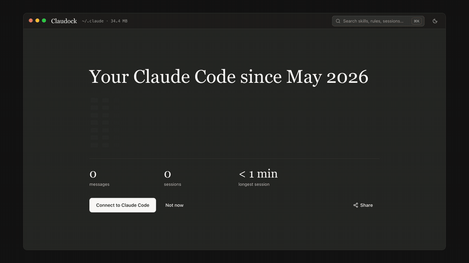

# Claudock

Manage your Claude Code setup (settings, hooks, skills, MCP servers, memory and more) in one window, without hand-editing the JSON and Markdown in `~/.claude`.

**Beta, actively maintained** · macOS, Windows, Linux · [MIT license](LICENSE.md) · Unofficial, not affiliated with Anthropic

**[Download](https://github.com/behkha/claudock/releases/latest)** · [Website](https://behkha.github.io/claudock/)



## What it does

Claudock is a desktop app for the Claude Code config folder (`~/.claude`, or wherever `CLAUDE_CONFIG_DIR` points) and the MCP servers in `~/.claude.json`. It has one screen for each part of the folder:

- **Configure:** `settings.json` and `settings.local.json` as a form or raw JSON with history, `CLAUDE.md` and `rules/`, hooks, permissions
- **Extend:** skills (turn on or off, edit, duplicate), agents, commands, plugins, mods (what each one draws, hooks and reaches; keep the ones Claude drafts), MCP servers
- **Your data:** projects and their session transcripts, memory, plans, prompt history
- **Maintain:** disk use per folder with cleanup suggestions, plus snapshots and `.bak` files you can diff and restore
- **Share stats:** a card of your Claude Code numbers (messages, sessions, longest session, peak hour, top model, activity) from Claude Code's own `stats-cache.json`, to copy, save or post on X. It never shows project names or prompts.

⌘K (Ctrl+K on Windows and Linux) searches skills, agents, rules, hooks, sessions, memory and settings keys.

## Why not just edit the files

Claude Code keeps its config in dozens of JSON, JSONL and Markdown files, and rewrites `~/.claude.json` while it runs. Claudock edits them safely:

- Before every change it saves a snapshot of the file outside `~/.claude`. It then writes to a temp file and renames it over the original, so a crash can't leave a half-written file. JSON is validated before it is written.
- For `~/.claude.json` it re-reads the file right before writing and changes only the key you edited, so it doesn't overwrite what Claude Code wrote in the meantime.
- Deletes go to the OS Trash.
- It never reads `.credentials.json` or `sessions/*.key`. They show up as locked rows.

What it doesn't do: it doesn't run, update or sign in to Claude Code, and it doesn't sync settings between machines. It only works on the config folder and `~/.claude.json`, not on the `.claude/` folders inside your repositories. If you only change a setting now and then, Claude Code's own `/config` and `/permissions` commands are enough.

At launch Claudock downloads Anthropic's public settings docs (code.claude.com) and the Claude Code JSON schema to power the JSON editor's suggestions. It asks json.schemastore.org and the schema's GitHub mirror (raw.githubusercontent.com) at the same time and uses whichever answers first. It sends nothing about your config.

## Try it without touching your config

Requires Node.js 22.12 or later (Electron 45 and Vite 8 need it) and git.

```sh
git clone https://github.com/behkha/claudock.git
cd claudock
npm install
npm run dev
```

`npm run dev` opens the app on a synthetic config folder that it generates in `./.fixture/claude`. To look at your real `~/.claude` with every write turned off, run `npm run dev:real` instead.

## Install

Download the installer for your computer from the [latest release](https://github.com/behkha/claudock/releases/latest):

| Platform | File |
|---|---|
| macOS, Apple silicon | `Claudock-<version>-arm64.dmg` |
| macOS, Intel | `Claudock-<version>-x64.dmg` |
| Windows | `Claudock-Setup-<version>.exe` |
| Linux | `.AppImage` (`x86_64`, `arm64`) or `.deb` (`amd64`, `arm64`) |

The builds are not notarized or code-signed yet, so the first launch needs one extra step:

- **macOS:** open the app once, click Done when macOS says it can't verify it, then click **Open Anyway** in System Settings › Privacy & Security. If macOS says the app is damaged, run `xattr -dr com.apple.quarantine /Applications/Claudock.app`.
- **Windows:** if SmartScreen shows "Windows protected your PC", click **More info**, then **Run anyway**.

To build an installer yourself from the clone above, run `npm run dist:mac` (or `dist:win`, `dist:linux`). The output goes to `./dist`. Pushing a `v*` tag that matches `package.json`'s version builds all three platforms in GitHub Actions and attaches them to a draft release (`.github/workflows/release.yml`).

The installed app reads and writes `~/.claude`, or the folder in `CLAUDE_CONFIG_DIR` if you set it.

## Status

Beta (v0.1.0), actively maintained. Bug reports are welcome in [Issues](https://github.com/behkha/claudock/issues).

## License

Claudock is open source under the [MIT License](LICENSE.md).

Claudock is unofficial and is not affiliated with or endorsed by Anthropic. It uses Anthropic's palette and type styles but not the Claude or Anthropic logos.

## Development

The fixture rule, scripts, code layout and how to add an IPC method are in [docs/DEVELOPMENT.md](docs/DEVELOPMENT.md). The build spec is [docs/SPEC.md](docs/SPEC.md).
